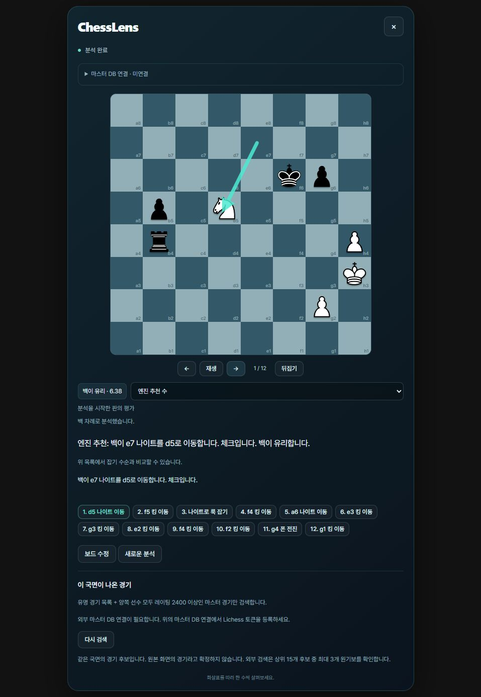

# ChessLens

[English](README.md) · [한국어](README.ko.md)

**체스 스크린샷을 첨부하고 판을 확인한 뒤, Stockfish 분석 수순을 살펴보는 로컬 앱입니다.**

PNG/JPEG에서 말을 인식하고, 필요한 칸을 수정하고, 게임 상태를 직접 확인합니다.
엔진 수순을 재생하거나 같은 국면이 나온 실제 경기를 찾아볼 수 있습니다.
기록된 특정 수와 엔진 추천을 비교하는 기능도 포함합니다.

저장소 이름은 원래 이름인 `Image2PGN`을 유지합니다. 스크린샷 한 장만으로는
그 국면에 이르기까지의 전체 기보를 복원할 수 없습니다.

[시각적 작동 설명](https://whichai.fyi/chesslens#image-flow) · [문제 제보](https://github.com/realseungju/Image2PGN/issues)

설명 사이트는 미리 기록한 예시를 보여줍니다. 아래 앱은 내 컴퓨터에서 실제 인식과
분석을 실행합니다. 현재 설명 화면의 UI는 한국어입니다. 기본 README는 영어이며,
이 문서는 같은 내용을 옮긴 한국어판입니다.

<details>
<summary>실제 로컬 앱 분석 화면</summary>



포함 예제의 실제 실행 화면입니다. 표시되는 점수와 수순은 엔진 버전·탐색 시간에 따라 달라질 수 있습니다.

</details>

## 빠른 시작

[uv](https://docs.astral.sh/uv/getting-started/installation/)와 별도로 설치한
[Stockfish 실행 파일](https://stockfishchess.org/download/)이 필요합니다.
uv가 Python 3.12와 프로젝트 환경을 준비합니다. 처음에는 의존성을 내려받고,
다음 실행부터는 설치된 환경을 재사용합니다. LLM 서비스나 API 키는 필요하지 않습니다.

```sh
git clone https://github.com/realseungju/Image2PGN.git
cd Image2PGN
uv run chesslens
```

Stockfish가 `PATH`에 없다면 실행 파일 경로를 지정합니다.

```powershell
uv run chesslens --engine "C:\tools\stockfish\stockfish.exe"
```

```sh
# Linux/macOS 예시
uv run chesslens --engine /path/to/stockfish
```

실행기는 포함된 분류 모델과 UCI 엔진의 작동을 확인한 뒤 서버를 시작하고,
**http://127.0.0.1:8771/** 을 엽니다. 종료하려면 터미널에서 **Ctrl+C**를 누릅니다.
Stockfish 압축 파일은 먼저 풀어야 합니다. 폴더나 ZIP 대신 실행 파일을 지정하세요.

```sh
uv run chesslens --doctor                 # 서버 실행 없이 설정 점검
uv run chesslens --no-browser             # 브라우저를 열지 않고 주소 출력
uv run chesslens --port 8787              # 다른 포트 사용
uv run chesslens --model /path/model.pt   # 호환되는 사용자 모델 사용
```

`CHESSLENS_MODEL_PATH`와 `CHESSLENS_ENGINE_PATH`도 지원합니다. 명령행 인수가
환경변수보다 우선합니다. 엔진은 `PATH`와 `./stockfish/`, `~/Documents/stockfish/`의
Windows `stockfish*.exe` 파일에서도 찾습니다. 기본 웹 앱과 포함 모델은 다른 저장소나
개인 폴더의 Python 코드·모델에 의존하지 않습니다.

## 이미지 첨부, 판 확인, 분석

1. **체스 화면 첨부**를 눌러 PNG/JPEG를 선택합니다. 저장소의 `image/chess_img4.png`로
   시험할 수 있습니다. 업로드 제한은 10 MiB, 2,400만 화소입니다.
2. **분석 시작**을 누릅니다. 인식은 말의 배치를 제안합니다. 누구 차례인지나 앞선 경기
   상황까지 알아내는 것은 아닙니다.
3. 원본의 판 부분과 인식 결과를 비교합니다. **판 인식 수정**을 열고 말 또는 빈칸을
   고른 뒤 수정할 칸을 누릅니다. 노란 칸은 특히 확인하세요.
4. **백 차례 / 흑 차례**를 고릅니다. **게임 상태와 전체 FEN 확인**에서 캐슬링·앙파상
   권리와 수 번호를 확인하거나 수정합니다. 이미지에서 제안하는 특수 권리의 초깃값은
   없음(`-`)입니다. 실제 게임 상태에 맞게 직접 확인해야 합니다.
5. **판 전체 분석**을 유지하거나, 확인할 상대 기물과 잡기 수를 고릅니다. 말의 위치와
   게임 상태를 확인하고 체크합니다. 화살표·색 표시 확인이 요청되면 함께 확인합니다.
6. **이 판으로 분석**을 누릅니다. 재생, 이전/다음, 뒤집기로 수순을 살펴봅니다.
   **새로운 분석**으로 다음 국면을 시작할 수 있습니다.

이미 알고 있는 FEN은 이미지 대신 **판 정보 직접 입력 (FEN)**에 입력할 수 있습니다.
엔진이 이어가는 수는 가상 수순이며, 이미지에서 복원한 실제 기보가 아닙니다.

## 실제 경기 검색과 특정 수 비교

- 포함된 목록에는 **선정한 역사적 경기 12개**가 있습니다.
  [기보 출처 문서](image2pgn/data/README.md)에 출처와 유래가 정리되어 있습니다.
- 판을 확인하고 분석하면 같은 국면의 실제 경기를 찾고, 처음부터 또는 해당 장면부터
  재생할 수 있습니다. 일치하는 경기는 후보이며 스크린샷 원본 경기라는 증거는 아닙니다.
- 실제 경기 재생 중 수를 선택하고 **이 수와 엔진 추천 비교**를 누릅니다. 기록된 수순과
  추천 수순은 따로 표시합니다. 추천과 다르다는 이유만으로 실수라고 판정하지 않습니다.
- 선택 기능인 **마스터 DB 연결**은 Lichess Masters를 검색합니다. 토큰은 로컬 앱에
  직접 입력합니다. 이 검색에는 권한 범위 선택이 필요하지 않습니다. 반환되는 두 선수의
  레이팅이 모두 2400 이상이어야 하며, 일반 사용자 경기는 검색하지 않습니다.
- 기본적으로 토큰은 메모리에만 보관합니다. 저장을 선택하면 Windows 사용자 DPAPI로
  암호화하며, 다른 운영체제에서는 이 저장 기능을 제공하지 않습니다. 로컬 연결 해제는
  Lichess 사이트의 토큰 자체를 폐기하지 않습니다.

## 포함된 기능과 구조

```text
스크린샷 → 판 찾기 → 64칸 기물 분류
         → 사람이 배치·게임 상태 확인
         → Stockfish → 합법 수순 재생
                      ↘ 같은 국면의 경기 검색 → 실제 수와 추천 비교
```

| 위치 | 역할 |
| --- | --- |
| `image2pgn/launcher.py` | 단일 실행과 설정 점검 |
| `image2pgn/webapp.py`, `explanation_api.py` | 로컬 업로드 API와 확인·분석 작업 |
| `image2pgn/board*.py`, `cnn.py`, `orientation.py` | 판 위치·기하와 기물 인식 |
| `image2pgn/analyze.py`, `explanations.py` | 엔진 분석과 합법 수순 기반 설명 |
| `image2pgn/master_games.py`, `move_comparison.py` | 실제 경기 검색과 특정 수 비교 |
| `image2pgn/web/` | 웹 화면, 기물 SVG, 글꼴 |
| `image2pgn/assets/` | 포함된 실험용 분류 모델과 출처 |
| `desktop/` | 선택 사항인 Electron 팝업 연결 |
| `infra/`, `tests/` | 실험 도구와 회귀 검사 |

기본 화면은 `/`이며 `/explain`도 같은 화면을 엽니다. 이전 다중 이미지 작업 화면은
`/workspace`에 보존하고 기본 앱에서 연결합니다. 그곳에서 확인한 FEN을 설명 화면으로
전달할 수 있습니다.

## 모델, 엔진, 한계

새로 받은 코드에서도 이미지 첨부를 실행할 수 있도록 소형 실험용 PieceCNN 모델을
포함합니다. SHA-256과 원본 실험은 [model.json](image2pgn/assets/model.json)에,
용도와 한계는 [모델 설명](image2pgn/assets/README.md)에 기록했습니다. 다른 모델은
PieceCNN 구조와 기물 분류 이름이 호환되어야 합니다.

Stockfish는 포함하지 않으며 자동으로 내려받지 않습니다. 공식 배포본에서 내 CPU와
운영체제에 맞는 실행 파일을 선택하세요. 기본 uv 설정은 Windows/Linux에서 CPU용
PyTorch를 사용합니다. GPU 학습은 선택 사항이며 앱 실행에 필요하지 않습니다.

- 모든 판을 확인해야 합니다. 판 정렬, 방향, 덧그림, 낯선 테마, 기물 색상, 작은 기물에서
  인식 오류가 날 수 있습니다.
- 한 장의 이미지로 차례, 캐슬링·앙파상 권리, 수 번호, 앞선 수를 확정할 수 없습니다.
  FEN의 기본값은 그 정보가 사실이라는 근거가 아닙니다.
- 제한 시간 탐색 결과는 깊이·시간·엔진 버전에 따라 바뀝니다. 메이트 점수는 확정된
  폰 손실 수치로 변환하지 않습니다.
- 로컬 프로토타입입니다. 실행기는 loopback에 바인딩하고 기존 Host/Origin 및 세션
  토큰 검사를 유지합니다.
- 이미지는 로컬에서 처리하고 임시 입력 파일을 지웁니다. 판 부분 이미지는 취소·만료 전까지
  로컬 세션에 남습니다. 선택형 Masters 검색은 국면 질의를 보내며 스크린샷을 보내지 않습니다.
- 새로운 스크린샷, DPI·배율 조합, Linux와 macOS는 사용자 검증이 더 필요합니다.
  자동 검사와 개발용 예제는 일반적인 인식 정확도를 보장하지 않습니다.

## 개발 및 고급 사용

```sh
uv sync --group dev
uv run pytest tests -q
uv run python infra/check_javascript.py
uv build
```

커밋된 `uv.lock`이 해석된 의존성 버전을 고정합니다. Node.js는 JavaScript 회귀 검사에
필요하며 로컬 웹 앱 실행에는 필요하지 않습니다. 검사 실행기는 Windows/Linux에서
작동하고, 라벨 검토 도구에는 합성 입력을 생성하므로 개인 학습 데이터가 필요하지 않습니다.

기존 CLI 인식·분석과 학습 명령도 사용할 수 있습니다.

```sh
uv run python -m image2pgn --help
uv run python -m image2pgn analyze-fen --fen "FEN" --engine /path/to/stockfish
```

이전 학습 명령과 개발 측정은 [과거 작업 흐름](docs/legacy-workflows.md)과
[MODEL_HISTORY.md](MODEL_HISTORY.md)에 보존했습니다. 현재 빠른 시작이나 성능 보장은
아닙니다. 선택형 데스크톱 팝업은 [desktop/README.md](desktop/README.md)를 참고하세요.

## 문제 해결

| 증상 | 확인할 것 |
| --- | --- |
| Stockfish를 찾지 못함 | 압축을 풀고 `--engine`에 실행 파일을 지정합니다. 폴더·ZIP은 실행 파일이 아닙니다. |
| 엔진 실행 실패 | 운영체제·CPU에 맞는 배포본인지 확인하고 `uv run chesslens --doctor`를 실행합니다. |
| 모델 없음·체크섬 불일치 | 저장소의 `image2pgn/assets/`를 복원하거나 호환되는 모델을 지정합니다. |
| 포트 사용 중 | 다른 인스턴스를 종료하거나 `--port 8787`을 사용합니다. |
| 판·잡기 선택이 잘못됨 | 말을 수정하고 차례·게임 상태를 확인한 뒤 확정합니다. |
| Masters 사용 불가 | 오프라인 목록과 분석은 계속 사용할 수 있습니다. 외부 검색에는 유효한 사용자 토큰과 네트워크가 필요합니다. |

기물 그림과 글꼴의 제삼자 고지는 [pieces/NOTICE.txt](image2pgn/web/pieces/NOTICE.txt),
[pieces/COPYING.txt](image2pgn/web/pieces/COPYING.txt),
[Pretendard-LICENSE.txt](image2pgn/web/fonts/Pretendard-LICENSE.txt)에 보존했습니다.
Stockfish와 python-chess의 라이선스는 각 배포본을 확인하세요.
이번 정리로 프로젝트 전체에 적용하는 새 라이선스를 추가하지는 않았습니다.
